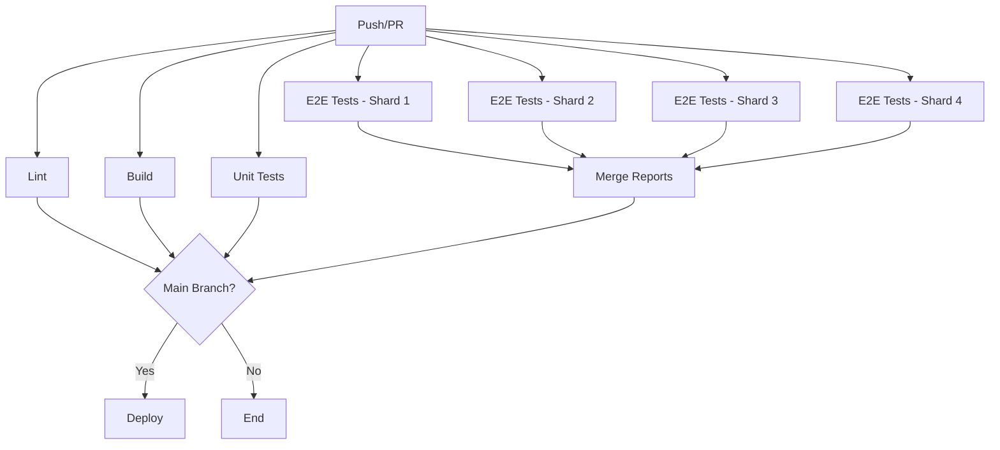

# CI/CD Pipeline

teXt0wnz uses GitHub Actions for continuous integration, testing, and deployment. The pipeline ensures code quality, runs comprehensive tests, and automatically deploys to GitHub Pages.

## Overview

The CI/CD system consists of 14 workflow files that handle:

- Code quality checks (linting, formatting, type checking)
- Automated testing (unit, DOM, E2E)
- Golden screenshot baseline regeneration
- Build verification
- Docker image creation
- Deployment to GitHub Pages, plus one-shot branch previews
- Versioned GitHub releases
- Wiki documentation synchronization
- Copilot coding agent environment setup

## Workflow Architecture

```
┌─────────────────────────────────────────────────────────────┐
│                      test-suite.yml                         │
│                    (Main Orchestrator)                      │
└──────────┬──────────────────────────────────────────────────┘
           │
           ├──> lint.yml          (Code Quality)
           ├──> build.yml         (Build Verification)
           ├──> unit.yml          (Unit Tests)
           ├──> e2e.yml           (E2E Tests - 4 Shards)
           ├──> merge-reports.yml (Merge E2E Results)
           └──> deploy.yml        (GitHub Pages Deploy)

┌─────────────────────────────────────────────────────────────┐
│                       release.yml                           │
│                   (Release Orchestrator)                    │
└──────────┬──────────────────────────────────────────────────┘
           │
           ├──> build.yml         (Release Build)
           └──> docker-build.yml  (Editor Image)

Standalone:

  docker-build.yml        (Editor Container Image)
  ci-docker-build.yml     (CI Container Image)
  golden-update.yml       (Golden Screenshot Baselines)
  pages-preview.yml       (One-Shot Branch Preview)
  wiki.yml                (Documentation Publisher)
  copilot-setup-steps.yml (Copilot Agent Environment)
```

## Core Workflows

### 1. test-suite.yml (Main Pipeline)

**Purpose:** Orchestrates the complete CI/CD pipeline for code changes.

**Triggers:**

- Push to `main` branch (excluding docs and markdown files)
- Pull requests to any branch
- Manual workflow dispatch

**Jobs:**

1. **lint** - Code quality checks (ESLint, Prettier, tsc)
2. **build** - Build verification
3. **unit** - Unit test execution
4. **e2e** - End-to-end tests (4-way sharded for speed)
5. **reports** - Merge E2E blob reports; runs even when a shard fails, and skips only when the run is cancelled
6. **deploy** - Deploy to GitHub Pages (main branch only; needs lint, unit, build, and reports)

**Path Ignores:**

- `docs/**`
- `**/*.md`
- `LICENSE.txt`
- `OSSMETADATA`
- `.gitattributes`
- `.gitignore`
- `.prettierignore`

**Permissions:**

```yaml
contents: write
pages: write
id-token: write
packages: read
```

**Workflow:**



### 2. lint.yml

**Purpose:** Validates code style, formatting, and types.

**Called by:** test-suite.yml

**Steps:**

1. Checkout code
2. Setup Bun
3. Install dependencies
4. Run `bun lint:check` (ESLint)
5. Run `bun format:check` (Prettier)
6. Run `bun types:check` (`tsc --noEmit`)

**Coverage:**

File patterns live in the `config` block of `package.json`:

- Lint: `src/**/*.html`, `src/{*,js/**/*}.js`, `tests/**/*.js`, `tools/**/*.js`
- Format: `src/**/*.css`, `docs/**/*.md`, `src/js/**/*.ts`, `tests/**/*.ts`

**Linting Rules:**

- ESLint configuration from `eslint.config.js`
- HTML linting with `@html-eslint/eslint-plugin`
- Stylistic rules with `@stylistic/eslint-plugin`

### 3. build.yml

**Purpose:** Verifies the application builds successfully and produces expected artifacts.

**Called by:** test-suite.yml and release.yml

**Steps:**

1. Checkout code
2. Setup Bun
3. Install dependencies
4. Point `.env` at the GitHub Pages domain
5. Build application with `bun bake`
6. Append the repo and site URLs to `LICENSE.txt` and copy it into `dist/`
7. Verify build artifacts exist
8. Upload build artifact (main branch only)
9. Add artifact download instructions to the run summary

**Verified Artifacts:**

- Directory structure (`dist/ui`, `dist/ui/js`, `dist/ui/img`, `dist/ui/fonts`)
- Static files (icons, manifest, HTML, humans.txt, robots.txt, sitemap.xml, service worker, Topaz woff2 font)
- Hashed bundles (`canvas`, `core`, `editor`, `fileops`, `network`, `palette`, `tools`), plus `stylez*.css`, `icons*.svg`, and screenshots
- Module workers at the dist root (`collabWorker*.js`, `journalWorker*.js`)

**Artifact Upload:**

- Name: `editor-build`
- Retention: 3 days
- Only on successful builds from the `main` branch

### 4. unit.yml

**Purpose:** Executes unit and DOM tests with coverage reporting.

**Called by:** test-suite.yml

**Steps:**

1. Checkout code with full history
2. Setup Bun
3. Install dependencies
4. Run `bun test:unit` (Vitest with coverage; the suite covers unit and DOM tests, and excludes the Playwright directories)
5. Inject dark theme CSS into coverage report
6. Upload coverage artifact
7. Add artifact download instructions to the run summary

**Test Configuration:**

- Test runner: Vitest
- Environment: jsdom
- Coverage provider: v8
- Output: `tests/results/coverage/`

**Coverage Report:**

- HTML report with dark theme support
- Statement, branch, function, and line coverage
- Uploaded as artifact: `unit-test-results`
- Retention: 3 days

**Dark Theme Injection:**
Appends CSS for dark mode support to the coverage report's `base.css`:

```css
@media (prefers-color-scheme:dark) { ... }
```

### 5. e2e.yml

**Purpose:** Runs end-to-end and golden screenshot tests in real browsers using Playwright.

**Called by:** test-suite.yml (4 times, shards `1/4` through `4/4`)

**Inputs:**

- `shard` (string, default `1/1`)

**Sharding Strategy:**
test-suite.yml fans the suite out across 4 parallel shards:

- Shard 1/4
- Shard 2/4
- Shard 3/4
- Shard 4/4

**Container:**

```yaml
image: ghcr.io/xero/text0wnz/ci:latest
options: --user root
```

[ci docker image](https://github.com/xero/text0wnz/pkgs/container/text0wnz%2Fci)

**Playwright Projects:**

- Chrome, Firefox, and WebKit run the e2e specs
- Chromium runs the golden screenshot suites (`golden`, `golden-gl`) and the WebGL rail (`chromium-gl`)

**Steps:**

1. Checkout code
2. Install dependencies with Bun
3. Set localhost domain in `.env`
4. Build application with `bun bake`
5. Derive the artifact name from the shard
6. Run `bun test:e2e --shard={shard}`
7. Upload blob report

**Environment:**

- `HOME: /root`
- `PLAYWRIGHT_TEST_BASE_URL: http://localhost:8060`

**Artifacts:**

- Name: `blob-report-{shard}` with slashes replaced by hyphens, so shard 1/4 uploads `blob-report-1-4`
- Path: `blob-report`
- Retention: 1 day
- Always uploaded (even on failure)

**Permissions:**
`contents: read` plus `packages: read` to pull the CI image from GHCR.

### 6. merge-reports.yml

**Purpose:** Combines Playwright blob reports from all E2E shards into a single HTML report.

**Called by:** test-suite.yml

**Inputs:**

- `retention-days` (number, default 14)

**Steps:**

1. Checkout code
2. Install Bun and Playwright
3. Download all blob reports into `all-blob-reports`
4. Merge reports with `bunx playwright merge-reports --reporter html`
5. Upload merged report

**Input:**

- Downloads artifacts matching pattern: `blob-report-*`
- Merges multiple blob reports into one

**Output:**

- Artifact name: `merged-playwright-report`
- Path: `playwright-report`
- Retention: 14 days (configurable via the `retention-days` input)

### 7. golden-update.yml

**Purpose:** Regenerates the golden screenshot baselines and uploads them for review. Goldens are only valid when rendered inside the CI container (Linux, SwiftShader, device scale factor 1), so this workflow is the only sanctioned way to produce them. Never generate goldens on a workstation.

**Triggers:**

- Manual workflow dispatch
- Push touching `tests/golden/**` or the workflow file itself (workflow dispatch only registers on the default branch, so the push trigger lets regeneration runs ride feature branches)

**Container:** the same CI image as e2e.yml (`ghcr.io/xero/text0wnz/ci:latest`, `--user root`)

**Steps:**

1. Checkout code, install dependencies, set localhost domain in `.env`, and build
2. Run `bun test:e2e --project=golden --update-snapshots`
3. Run `bun test:e2e --project=golden-gl -g "unicode-mixed" --update-snapshots` for the GL-only unicode golden
4. Upload the regenerated baselines

**Artifact:**

- Name: `golden-snapshots`
- Path: `tests/golden/golden.spec.js-snapshots`
- Retention: 7 days

**Updating baselines:** download the artifact, review the images, drop them into `tests/golden/golden.spec.js-snapshots/`, and commit. See the [Testing Guide](testing.md) for how the golden suite asserts against these baselines.

### 8. deploy.yml

**Purpose:** Deploys the application and test reports to GitHub Pages.

**Called by:** test-suite.yml (only on main branch)

**Permissions:**

```yaml
contents: read
pages: write
id-token: write
```

**Concurrency:**

- Group: `pages`
- Cancel in-progress: false

**Jobs:**
Both jobs also guard themselves: they only run on `main` and never on pull request events.

#### build-artifacts

1. Download `editor-build` artifact
2. Download `unit-test-results` artifact
3. Download `merged-playwright-report` artifact
4. Organize files:
   ```
   release/
   ├── (application files)
   └── tests/
       ├── (unit coverage)
       └── e2e/
           └── (E2E report)
   ```
5. Upload pages artifact (3 day retention)

#### deploy

1. Deploy to GitHub Pages using pages artifact
2. Set environment: `github-pages`
3. Output deployment URL

**Deployed Structure:**

```
https://xero.github.io/text0wnz/
├── index.html              (Application)
├── ui/                     (Assets)
└── tests/
    ├── index.html          (Unit coverage)
    └── e2e/
        └── index.html      (E2E report)
```

### 9. pages-preview.yml

**Purpose:** One-shot GitHub Pages deploy of any ref, for previewing a branch before it lands on main.

**Trigger:** manual workflow dispatch on the branch to preview:

```bash
gh workflow run pages-preview.yml --ref my-branch
```

**Steps:**

1. Checkout code
2. Setup Bun
3. Install dependencies
4. Point `.env` at the GitHub Pages domain
5. Build application with `bun bake`
6. Upload `dist` as the pages artifact (3 day retention)
7. Deploy to GitHub Pages

**Cleanup:** none needed. The workflow shares the `pages` concurrency group with deploy.yml, and the next push to main redeploys main over the preview.

**Permissions:**

```yaml
contents: read
pages: write
id-token: write
```

## Release Workflow

### 10. release.yml

**Purpose:** Cuts a versioned GitHub release with build and container artifacts.

**Trigger:** manual workflow dispatch with a `version_type` choice input (`major`, `minor`, or `patch`). The release job only runs on `main`.

**Permissions:**

```yaml
contents: write
packages: write
```

**Jobs:**

1. **release** - Bumps `package.json` with `bun pm version`, commits and pushes the bump, tags `vX.Y.Z`, builds a changelog compare link against the previous tag, and creates the GitHub release with generated notes
2. **build** - Calls build.yml for a fresh `editor-build` artifact
3. **attach-build** - Zips the build into `editor-build.zip` and attaches it to the release
4. **containerize** - Calls docker-build.yml, passing the `DOCKERHUB_USERNAME` and `DOCKERHUB_TOKEN` secrets
5. **update-release-notes** - Appends `docker pull` commands for the new GHCR and Docker Hub images, read from the containerize job's outputs

Standalone server binaries are not part of the release. `bun binaries` (`tools/compileBinaries.js`) cross-compiles the collaboration server for 8 targets (Linux glibc and musl, macOS, and Windows, each on x64 and arm64). It runs locally only; no workflow invokes it.

## Docker Workflows

### 11. docker-build.yml

**Purpose:** Builds and publishes multi-architecture Docker images for the Editor.

**Triggers:**

- Manual workflow dispatch
- Workflow call (used by release.yml)
- Push to main when `Dockerfile` changes

**Workflow call contract:**

- Exports `ghcr` and `dockerhub` outputs (image refs with short-sha tags) for the caller's release notes
- Requires the `DOCKERHUB_USERNAME` and `DOCKERHUB_TOKEN` secrets

**Platforms:**

- `linux/amd64`
- `linux/arm64`

**Registries:**

1. GitHub Container Registry: `ghcr.io/xero/text0wnz`
2. Docker Hub: `xerostyle/text0wnz`

**Steps:**

1. Checkout code and setup Bun
2. Rewrite the OCI `created` and `version` labels in the `Dockerfile` and commit the change back to main (this is why the job holds `contents: write`)
3. Setup QEMU for multi-arch builds
4. Setup Docker Buildx
5. Login to GitHub Container Registry and Docker Hub
6. Extract metadata and the short-sha image refs
7. Build and push images with OCI annotations

**Tags:**

- `latest` (always)
- `sha-{short-sha}` (commit-based)

**Cache:**

- Type: GitHub Actions cache
- Mode: max (cache everything possible)

### 12. ci-docker-build.yml

**Purpose:** Builds the CI container image used by e2e.yml and golden-update.yml.

**Triggers:**

- Manual workflow dispatch
- Push to main when `.github/ci.Dockerfile` changes

**Base Image:**

```dockerfile
FROM oven/bun:debian AS bun
FROM mcr.microsoft.com/playwright:v1.59.1-jammy
```

The Bun binary is copied out of the first stage into the pinned Playwright image.

**Includes:**

- Bun runtime
- Playwright with all browsers (Chrome, Firefox, WebKit)
- ESLint and Prettier

**Steps:**

1. Checkout code and setup Bun
2. Rewrite the OCI `created` label in `.github/ci.Dockerfile` and commit the change back to main (this is why the job holds `contents: write`)
3. Setup Docker Buildx
4. Login to GitHub Container Registry with the `PKG_TOKEN` secret
5. Build and push the image

**Registry:**

- `ghcr.io/xero/text0wnz/ci:latest`

**Purpose:**
Provides a pre-configured environment for E2E and golden screenshot runs with all browsers and dependencies installed, reducing CI run time.

## Documentation Workflow

### 13. wiki.yml

**Purpose:** Synchronizes documentation from `/docs` to GitHub Wiki.

**Triggers:**

- Push to main branch with changes in `docs/**`
- Manual workflow dispatch

**Steps:**

1. Checkout repository
2. Checkout wiki repository (authenticated with the `CICD_TOKEN` secret)
3. Configure git with the triggering commit's author, falling back to the actor on manual dispatch
4. Clear wiki (except `.git` and `img` folders)
5. Copy docs to wiki
6. Overwrite `contributing.md`, `code_of_conduct.md`, and `security.md` from the `.github/` copies
7. Rename `README.md` to `Home.md`
8. Regenerate `_Footer.md` with the current copyright year and `_Sidebar.md` with the wiki navigation
9. Fix internal markdown links (remove `.md` extension)
10. Commit and push if changes exist

**Link Transformation:**

```perl
# Before: [link](document.md)
# After:  [link](document)
# Before: [link](document.md#section)
# After:  [link](document#section)
```

## Support Workflows

### 14. copilot-setup-steps.yml

**Purpose:** Prepares the environment for GitHub Copilot's coding agent, which picks this workflow up by its file and job name.

**Trigger:** workflow call

**Steps:**

1. Checkout code
2. Setup Bun
3. Install dependencies with both npm and Bun
4. Install eslint, prettier, and playwright globally

## Security

### Pinned Actions

All GitHub Actions use commit SHAs for security:

```yaml
actions/checkout@de0fac2e4500dabe0009e67214ff5f5447ce83dd # v6.0.2
oven-sh/setup-bun@0c5077e51419868618aeaa5fe8019c62421857d6 # v2.2.0
actions/upload-artifact@043fb46d1a93c77aae656e7c1c64a875d1fc6a0a # v7.0.1
actions/download-artifact@3e5f45b2cfb9172054b4087a40e8e0b5a5461e7c # v8.0.1
actions/upload-pages-artifact@fc324d3547104276b827a68afc52ff2a11cc49c9 # v5.0.0
actions/deploy-pages@cd2ce8fcbc39b97be8ca5fce6e763baed58fa128 # v5.0.0
docker/setup-qemu-action@ce360397dd3f832beb865e1373c09c0e9f86d70a # v4.0.0
docker/setup-buildx-action@4d04d5d9486b7bd6fa91e7baf45bbb4f8b9deedd # v4.0.0
docker/login-action@4907a6ddec9925e35a0a9e82d7399ccc52663121 # v4.1.0
docker/metadata-action@030e881283bb7a6894de51c315a6bfe6a94e05cf # v6.0.0
docker/build-push-action@bcafcacb16a39f128d818304e6c9c0c18556b85f # v7.1.0
softprops/action-gh-release@b4309332981a82ec1c5618f44dd2e27cc8bfbfda # v3.0.0
```

See: [other-tools/pin-github-action](other-tools.md#pin-github-action)

### Permissions

Each workflow uses least-privilege permissions:

| Workflow                                                    | Permissions                                                            |
| ----------------------------------------------------------- | ---------------------------------------------------------------------- |
| test-suite.yml                                              | `contents: write`, `pages: write`, `id-token: write`, `packages: read` |
| deploy.yml, pages-preview.yml                               | `contents: read`, `pages: write`, `id-token: write`                    |
| e2e.yml, golden-update.yml                                  | `contents: read`, `packages: read`                                     |
| release.yml                                                 | `contents: write`, `packages: write`                                   |
| docker-build.yml, ci-docker-build.yml                       | `contents: write`, `packages: write` (job level)                       |
| lint, build, unit, merge-reports, wiki, copilot-setup-steps | `contents: read`                                                       |

The Docker workflows hold `contents: write` because each one commits its OCI label bump back to main before building.

### Untrusted Commit Metadata

wiki.yml, docker-build.yml, and ci-docker-build.yml read `head_commit` fields (author name, email, message) to attribute their commits. Those fields are attacker-controlled, so the workflows pass them to the shell only as environment variables, never through script interpolation.

### Secrets

Required repository secrets:

| Secret               | Purpose                              | Used In                                     |
| -------------------- | ------------------------------------ | ------------------------------------------- |
| `GITHUB_TOKEN`       | Built-in token for GitHub API access | Most workflows                              |
| `DOCKERHUB_USERNAME` | Docker Hub login                     | docker-build.yml (passed in by release.yml) |
| `DOCKERHUB_TOKEN`    | Docker Hub password                  | docker-build.yml (passed in by release.yml) |
| `CICD_TOKEN`         | Wiki repository access               | wiki.yml                                    |
| `PKG_TOKEN`          | GitHub Packages access               | ci-docker-build.yml                         |

## Artifacts and Reports

### Build Artifacts

**editor-build**

- Content: Complete built application from `dist/`
- Produced by: build.yml on main pushes and release runs
- Used by: deploy.yml and release.yml (attach-build)
- Retention: 3 days

### Test Artifacts

**unit-test-results**

- Content: HTML coverage report from Vitest
- Path: `tests/results/coverage/`
- Includes: Dark theme CSS injection
- Used by: deploy.yml
- Retention: 3 days

**blob-report-{shard}**

- Content: Playwright E2E test results for one shard
- Path: `blob-report/`
- Used by: merge-reports.yml
- Retention: 1 day

**merged-playwright-report**

- Content: Combined E2E test HTML report
- Path: `playwright-report/`
- Used by: deploy.yml
- Retention: 14 days

**golden-snapshots**

- Content: Regenerated golden screenshot baselines
- Path: `tests/golden/golden.spec.js-snapshots/`
- Used by: humans; review the images and commit them to the repo
- Retention: 7 days

### Download Artifacts

**Via GitHub CLI:**

```bash
# List artifacts for a run
gh run view RUN_ID --json artifacts

# Download specific artifact
gh run download RUN_ID -n editor-build
gh run download RUN_ID -n unit-test-results
gh run download RUN_ID -n merged-playwright-report
gh run download RUN_ID -n golden-snapshots
```

**Via Workflow Summary:**
Artifacts are available in the "Artifacts" section of workflow runs, and the build and unit jobs link them from the run summary.

## Performance Optimization

### E2E Test Sharding

test-suite.yml splits the Playwright suite into 4 parallel shards:

```yaml
strategy:
  fail-fast: false
  matrix:
    shardIndex: [1, 2, 3, 4]
    shardTotal: [4]
```

Each shard builds the app and runs its quarter of the suite with 6 Playwright workers (`workers` in `playwright.config.js`).

### Caching

**Docker Build Cache:**

```yaml
cache-from: type=gha
cache-to: type=gha,mode=max
```

**Bun Dependencies:**
Bun's native caching handles `node_modules` efficiently.

**CI Container:**
The prebuilt `ghcr.io/xero/text0wnz/ci` image ships Bun, all Playwright browsers, and the lint toolchain, so E2E jobs skip browser installation entirely.

### Conditional Execution

- Deployment only runs on main branch
- The `editor-build` upload skips for non-main branches
- Path filters prevent unnecessary runs

## Status Badges

The repository README includes these CI/CD badges:

```markdown
[](https://github.com/xero/teXt0wnz/actions/workflows/test-suite.yml?query=branch%3Amain)
[](https://github.com/xero/text0wnz/deployments)
[](https://github.com/xero/text0wnz/wiki)
```

## Monitoring and Debugging

### Viewing Workflow Runs

**GitHub UI:**

1. Navigate to Actions tab
2. Select workflow from sidebar
3. Click on specific run
4. View job details and logs

**GitHub CLI:**

```bash
# List recent runs
gh run list --workflow=test-suite.yml

# View run details
gh run view RUN_ID

# Watch run in real-time
gh run watch RUN_ID

# View logs
gh run view RUN_ID --log
```

### Debugging Failed Workflows

**Check Logs:**

1. Open failed workflow run
2. Click on failed job
3. Expand failed step
4. Review error messages and stack traces

**Common Issues:**

**Build Failures:**

- Check `bun bake` output
- Verify `vite.config.js` configuration
- Check for missing dependencies

**Test Failures:**

- Review test logs
- Check screenshots (E2E) in artifacts
- Verify browser compatibility
- Golden mismatches after an intentional rendering change mean the baselines need regeneration via golden-update.yml

**Deployment Failures:**

- Check Pages settings in repository
- Verify permissions
- Review artifact upload/download steps

**Docker Build Failures:**

- Check Dockerfile syntax
- Verify base images are available
- Check registry authentication

### Re-running Workflows

**Via GitHub UI:**

1. Open failed workflow run
2. Click "Re-run all jobs" or "Re-run failed jobs"

**Via GitHub CLI:**

```bash
# Re-run entire workflow
gh run rerun RUN_ID

# Re-run only failed jobs
gh run rerun RUN_ID --failed
```

## Local Testing

### Running Tests Locally

**Lint, format, and types:**

```bash
bun lint:check
bun format:check
bun types:check
```

**Build:**

```bash
bun bake
```

**Unit Tests:**

```bash
bun test:unit
```

**E2E Tests:**

```bash
bun test:e2e
```

Golden screenshot assertions are skipped outside CI (`ignoreSnapshots` in `playwright.config.js`); the flows still run, but pixel comparisons only happen in the CI container.

### Docker Build Testing

**Standard build:**

```bash
docker buildx build -t text0wnz:local .
```

**Multi-arch build:**

```bash
docker buildx build --platform linux/amd64,linux/arm64 -t text0wnz:local .
```

**Run locally:**

```bash
docker run -p 80:80 -e NODE_ENV=development text0wnz:local
```

### CI Container Testing

**Build CI image:**

```bash
docker build -f .github/ci.Dockerfile -t text0wnz-ci:local .
```

**Run E2E tests in container:**

```bash
docker run -v $(pwd):/app -w /app text0wnz-ci:local bun test:e2e
```

## Best Practices

### Adding New Tests

1. Write tests locally first
2. Ensure tests pass locally
3. Commit and push
4. Monitor CI run
5. Fix any CI-specific issues

### Modifying Workflows

1. Test changes in a feature branch
2. Use `workflow_dispatch` for manual testing
3. Check workflow syntax with:

   ```bash
   # Install actionlint
   brew install actionlint  # macOS
   # or download from: https://github.com/rhysd/actionlint

   # Validate workflow
   actionlint .github/workflows/*.yml
   ```

4. Review security implications
5. Update documentation

### Managing Secrets

1. Use GitHub repository settings
2. Never commit secrets to code
3. Rotate secrets regularly
4. Use environment-specific secrets
5. Audit secret usage in workflows

## Related Documentation

- [Testing Guide](testing.md) - Test infrastructure details
- [Building and Developing](building-and-developing.md) - Build process
- [Environment Variables](environment-variables.md) - The `.env` file the workflows rewrite
- [Docker](docker.md) - Container deployment
- [Webserver Configuration](webserver-configuration.md) - Production deployment

## Resources

- [GitHub Actions Documentation](https://docs.github.com/en/actions)
- [Docker Build Documentation](https://docs.docker.com/build/)
- [Playwright CI Documentation](https://playwright.dev/docs/ci)
- [Vitest Coverage](https://vitest.dev/guide/coverage.html)
